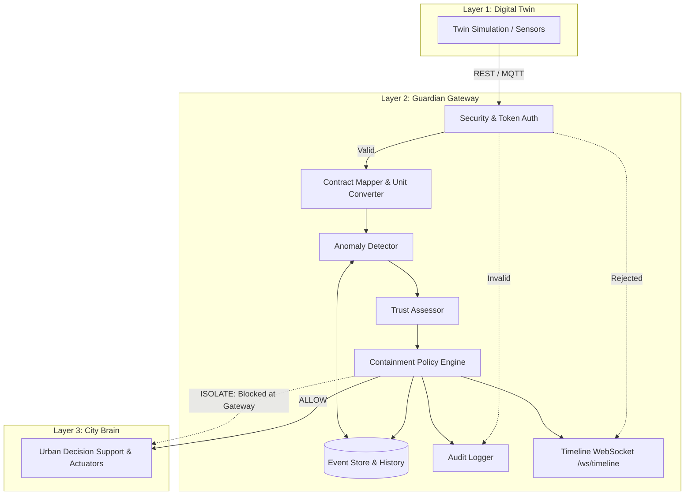

# Guardian Architecture Specification (Layer 2)

## 1. System Context & Topology

Guardian is the zero-trust cyber-physical verification gateway deployed between Digital Twin simulations (Layer 1) and municipal City Brain decision intelligence (Layer 3).

---

## 2. Component Directory Responsibilities

| Subsystem | Owner | Purpose |
|---|---|---|
| `core/history.py` | Member 3 + 4 | Statistical baseline calculations, frozen sensor detection, sliding window metrics |
| `core/anomaly_detector.py` | Member 3 + 4 | Sudden spike detection, physical bounds checks, incoherence evaluation |
| `core/trust_assessor.py` | Member 3 + 4 | Dynamic trust scoring (`TRUSTED`, `SUSPICIOUS`, `UNTRUSTED`) |
| `core/containment.py` | Member 3 + 4 | Containment enforcement (`ALLOW`, `ISOLATE`, `QUARANTINE`) |
| `audit/logger.py` | Member 4 + 3 | Structured, correlation-linked JSON audit logging |
| `audit/event_store.py` | Member 4 + 3 | Temporal in-memory buffer and persistence store |
| `audit/timeline.py` | Member 4 + 3 | Real-time WebSocket timeline broadcasting for Requirement R3 |
| `orchestration/pipeline.py` | Member 4 | End-to-end pipeline execution with causality guarantees |
| `security/` | Member 2 + 5 | HMAC admission (`gate.py`), freshness, replay cache, layer authorization |
| `adapters/` | Member 1 + 2 + 6 | REST & MQTT protocol connectors, canonical unit normalization |

---

## 3. Requirement Compliance

- **R1 (Independent Execution & Mocks)**: Guardian executes standalone with `mocks/mock_twin.py` and `mocks/mock_brain.py`.
- **R2 (One-Command Triggers & Logs)**: Scenarios execute with single scripts and persist execution logs in `logs/`.
- **R3 (Live Timeline)**: WebSocket `/ws/timeline` streams strictly correlated causal sequences (`READING_RECEIVED` ➔ `GUARDIAN_VERDICT` ➔ `ISOLATED` / `SENT_TO_BRAIN`).

